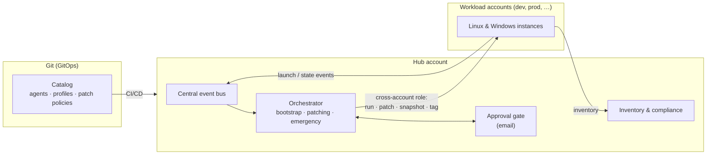

<div align="center">

# Patchgate

**Secure baselines. Gated patching. Any cloud.**

Cloud-agnostic platform to harden, bootstrap and patch Linux & Windows fleets across accounts — with approval gates and automatic rollback. AWS first, Azure next.

[](LICENSE)


</div>

---

> [!WARNING]
> Patchgate is in early development (**Phase 0**). The design is documented, but nothing is deployable yet. See the [roadmap](docs/roadmap.md).

## What is Patchgate?

Patchgate keeps your server fleet secure and up to date — from the moment a machine is launched to every patch it receives.

New instances are automatically bootstrapped with the agents and software you declare in a simple YAML catalog, then hardened against CIS benchmarks with continuous drift correction. Patches roll out in rings (dev → prod) with email approval gates, pre-patch snapshots and automatic rollback when health checks fail. Everything works across multiple accounts from a central hub, and produces compliance evidence ready for audits.

Patchgate is built with a **cloud-agnostic core** and **pluggable providers**. AWS is the first provider; Azure is on the roadmap.

## Features

| | Feature | Status |
|---|---|---|
| 🧩 | **Declarative agent catalog** — declare what to install and how (Chocolatey, MSI, packages, scripts), with checksum verification | Planned (Phase 2) |
| 🚀 | **Automatic bootstrap** — a new instance receives its agents and configuration, driven only by tags | Planned (Phase 2) |
| 🛡️ | **CIS hardening with drift correction** — manual changes are reverted to the baseline | Planned (Phase 3) |
| 🔁 | **Ring-based patching with approval gates** — snapshot before, health check after, automatic rollback | Planned (Phase 4) |
| 🖼️ | **Golden images** — hardened, pre-patched images gated by a vulnerability scan | Planned (Phase 5) |
| 🚨 | **CVE-driven emergency patching** — a critical finding triggers an accelerated flow | Planned (Phase 6) |
| 📊 | **Compliance and evidence** — dashboard, MTTP and audit-ready reports | Planned (Phase 6) |
| 🏢 | **Multi-account** — central hub; new accounts are onboarded automatically. Single-account mode supported | Planned (Phase 1) |
| ☁️ | **Multi-cloud by design** — AWS today, Azure next | Planned (Phases 7–8) |

## How it works



1. **Declare** agents, profiles and patch policies as YAML in Git.
2. **Tag** an instance with a profile (for example `Patchgate:Profile=web-windows`).
3. On launch, Patchgate **bootstraps** it: agents, Chocolatey packages and hardening.
4. On schedule, Patchgate **patches** it ring by ring, waiting for approval before production.
5. Every step produces **evidence** for compliance reports.

See [docs/architecture.md](docs/architecture.md) for the full design.

## Repository layout

```
core/         Cloud-agnostic: schemas, catalog, in-VM scripts, hardening, Python library
providers/    Cloud-specific implementations of the provider contract (aws/ first)
examples/     Ready-to-use setups (single-account, multi-account)
docs/         Architecture, roadmap, ADRs, security
```

## Documentation

- [Architecture](docs/architecture.md)
- [Roadmap](docs/roadmap.md)
- [Provider contract](providers/README.md)
- [Architecture Decision Records](docs/adr/README.md)
- [Threat model](docs/security/threat-model.md)

## Contributing

Contributions are welcome. Read [CONTRIBUTING.md](CONTRIBUTING.md) and the [Code of Conduct](CODE_OF_CONDUCT.md) first. AI coding agents should start with [AGENTS.md](AGENTS.md).

## Security

Please **do not** open public issues for vulnerabilities. See [SECURITY.md](SECURITY.md).

## License

[Apache License 2.0](LICENSE)
