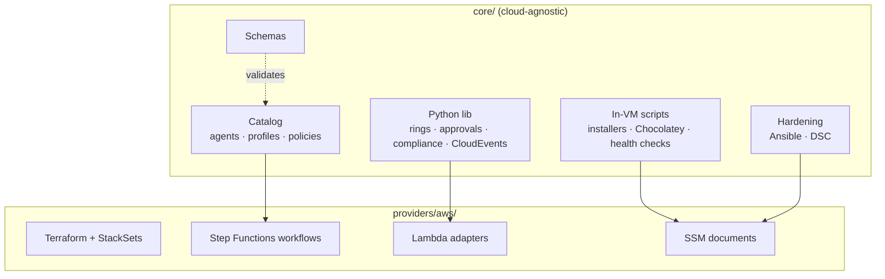
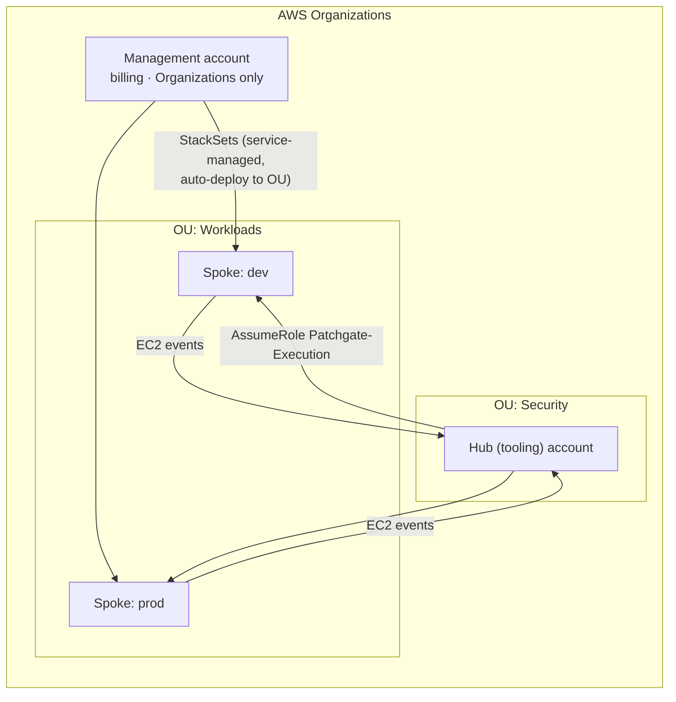
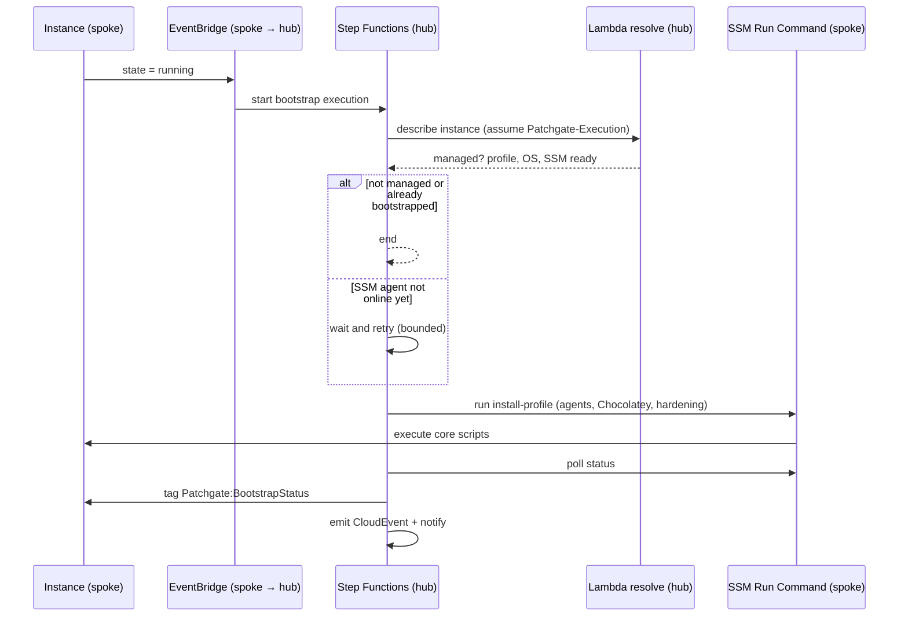
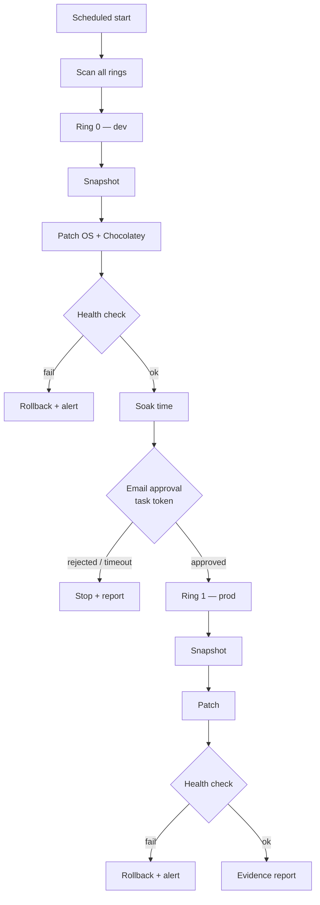

# Architecture

> Status: AWS provider; Phases 0–4a implemented and verified in a lab (see the [roadmap](roadmap.md)).

## Goals

- **Secure from the first boot:** instances receive agents and a hardened baseline automatically.
- **Controlled change:** patches move through rings with explicit human approval before production.
- **Recoverable:** every change is preceded by a snapshot and followed by health checks; failures roll back.
- **Many accounts, one control point:** a central hub governs any number of workload accounts.
- **Declarative and auditable:** everything is defined in Git; every action leaves evidence.
- **Cloud-agnostic core:** adding a cloud means adding a provider, not rewriting the platform.

## Non-goals (for now)

- Managing containers or serverless workloads (Patchgate targets VMs).
- Replacing an EDR/antivirus — Patchgate installs and verifies the ones you choose.
- Multi-region active/active control plane.

## Building blocks

## AWS deployment model: hub and spoke

| Account | Contains |
|---|---|
| **Management** | Organizations, StackSets administration, billing. No workloads, no Patchgate runtime. |
| **Hub** | Central EventBridge bus, Step Functions workflows, approval API, Lambdas, SNS, inventory/evidence bucket, Image Builder pipeline, delegated admin for Security Hub and Inspector. |
| **Spoke** (each workload account) | `Patchgate-Execution` role (trusts hub roles only), EventBridge rule forwarding EC2 events to the hub, SSM documents, instance profile, CloudWatch log groups. |

**Single-account mode:** hub and spoke resources are deployed into the same account. The workflows are identical; only the account list changes ([ADR 0002](adr/0002-hub-and-spoke-multi-account.md)).

**Onboarding:** spoke resources are a CloudFormation StackSet with automatic deployment to the Workloads OU. A new account created in that OU is managed without manual steps.

## Flows

### Bootstrap (Day 1)

Triggered by events rather than `user_data` so every run is visible, retried and auditable ([ADR 0004](adr/0004-event-driven-bootstrap.md)).

### Drift (Day 2)

A State Manager association runs the `Patchgate-Drift` document every 30 minutes. The executor in
the VM re-checks the last applied plan when the profile's interval is due, corrects or reports per
category (`agents`, `apps`, `hardening`), reports only outside the profile's maintenance window,
and publishes findings as `io.patchgate` events that the hub emails. `patchgate-cli instance
reconcile` sends the same document with `Force=true` to check now
([ADR 0009](adr/0009-drift-modes-per-category-and-maintenance-window.md)).

### Patching with approval (Day 2)

Approval: SNS sends an email with signed approve/reject links → API Gateway → Lambda calls `SendTaskSuccess`/`SendTaskFailure` with the Step Functions task token.

### Emergency patch (Phase 6)

An Inspector finding with CVSS ≥ 9 on a managed instance starts the patch workflow for the affected instances only, with a shortened soak time and an expedited approval.

## Identity and permissions

- Hub roles (`patchgate-hub-orchestrator`, `patchgate-hub-resolver`) may assume only `Patchgate-Execution`, and only in accounts of the organization (`aws:ResourceOrgID`), so onboarded accounts work without hub changes ([ADR 0006](adr/0006-org-wide-hub-access-and-stackset-spokes.md)).
- `Patchgate-Execution` trusts those exact hub role ARNs and allows:
  - `ssm:SendCommand` only with `Patchgate-*` documents and on instances tagged `Patchgate:Managed=true`;
  - `ec2:CreateTags` only for tag keys `Patchgate:*`;
  - read-only describe calls.
- CI/CD uses GitHub OIDC; no long-lived access keys.

See the [threat model](security/threat-model.md).

## Tags

| Tag | Set by | Meaning |
|---|---|---|
| `Patchgate:Managed` | User | `true` opts the instance in |
| `Patchgate:Profile` | User | Catalog profile to apply |
| `Patchgate:Env` | User | Environment label (`dev`, `prod`, …) |
| `Patchgate:Ring` | User or profile | Patch ring number |
| `Patchgate:BootstrapStatus` | Patchgate | `Success` / `Failed` |
| `Patchgate:LastPatch` | Patchgate | Timestamp and result of the last patch |

## Other providers

The core (catalog, in-VM installers, hardening engines, plan composition) is cloud-agnostic. Another
cloud would be a new `providers/<cloud>/` implementing the [provider contract](../providers/README.md)
with that cloud's native services, without changes to `core/` ([ADR 0001](adr/0001-core-and-providers.md)).
No other provider is planned at the moment.

## Cost guardrails

- Workload region `us-east-2` (same pricing as `us-east-1`); the organization region SCP blocks most regional services in `us-east-1` for member accounts. Management-account resources (state bucket, CloudTrail, budgets) live in `us-east-1`.
- Serverless control plane (pay per use).
- No NAT Gateway: lab instances use a public subnet with no inbound rules and IMDSv2.
- AWS Budget with alerts and a Budget Action that blocks new instances above the limit.
- Ephemeral lab: created per test session, destroyed afterwards; a TTL reaper terminates instances older than 2 hours.
- `lab` is disposable and destroyed after each test session.
